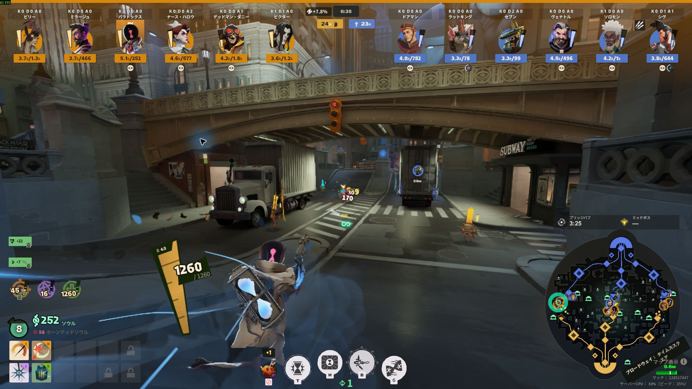
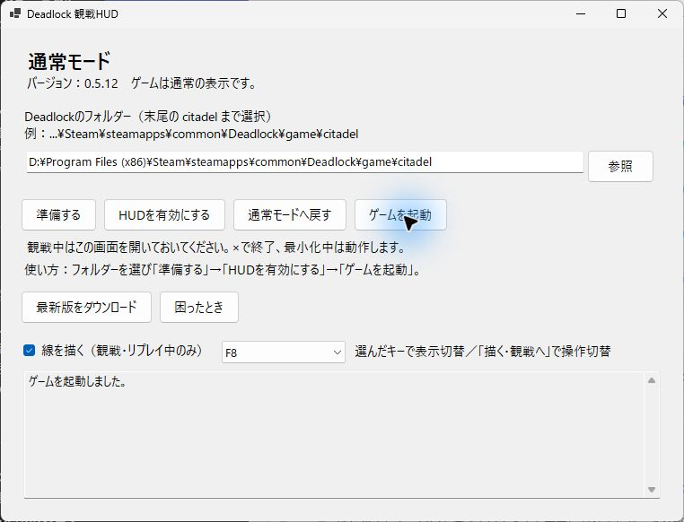
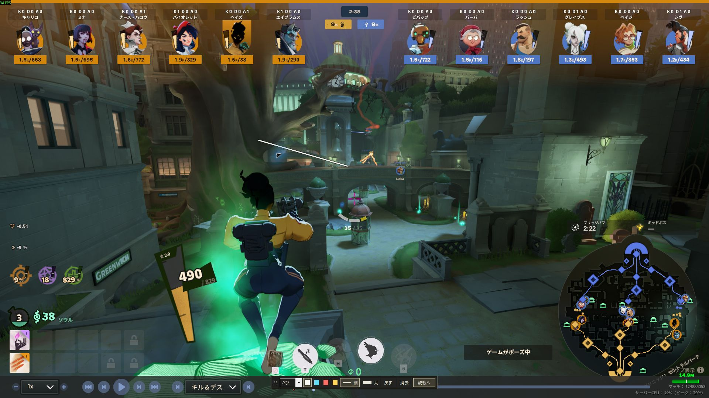

# Deadlock Spectator HUD

An unofficial HUD for Deadlock spectating and replays. It brings together purchases, ability upgrades, effects, souls and building HP, with on-screen drawing for commentary.

[日本語](README.md) · Windows 10–11 x64

> **0.6.0 release**: Extract the entire runnable ZIP from the [release page](https://github.com/aominn/deadlock-spectator-hud-public/releases/tag/v0.6.0). Code → Download ZIP contains development source.

*Captured in a real live spectator session using 0.5.12. All screenshots below are also from 0.5.12.*

## What it shows

| Area | Information |
| --- | --- |
| Hero row | Hero names, K/D/A, total souls / wallet, confirmed individual soul changes |
| Around each hero | Purchases, sales, ability upgrades, verified ultimate unlocks, supported buff/debuff icons |
| Ownership | Urn holder, up to two bridge buffs, individual Rejuvenator ownership |
| Center and minimap | Team soul lead, Rejuvenator charges, Mid Boss HP/timing, bridge buff cycle |
| Buildings and detail view | Lane-based damage HP bars, side-by-side shrines, three-column inventory in the detailed view |

Unknown data is not guessed. Complete coverage of every hero or effect is not guaranteed.

## First setup

Use a Windows PC with Steam and Deadlock installed. Runnable ZIPs include their runtime; separate Python, Node.js and .NET installation is not required.

1. **Extract the entire executable ZIP**. Do not run it from inside the archive.
2. Close Deadlock and open **HudManager.exe**.
3. Select **Deadlock/game/citadel** and choose **Set up**. Images are prepared from that PC's installed game.
4. Choose **Enable HUD → Launch game**, then open spectating or a supported replay.

*Manager example in normal mode; the photographed Windows UI is Japanese.*

Keep the manager open while spectating. It continues when minimized; **closing it also stops the companion**. Initial parsing or joining an ongoing match can require preparation time.

## Draw on the screen

Enable **Draw lines (spectating/replays only)** in the manager, then press **F8** in the game. Use your selected key if you changed it.

- Choose a color, thickness, pen or arrow on the toolbar.
- Choose **Watch**, or press Esc, to use game controls while retaining lines. Choose **Draw** to resume.
- F8 toggles the toolbar. Drawing covers the screen, including the minimap.
- Enable the drawing checkbox each time you reopen the manager. Drawing mode can reduce FPS.

[Drawing details](docs/DRAWING.txt)

## Restore, update and recover

**Restore normal mode:** close Deadlock, then choose **Restore normal mode** in the manager.

**Update:** close the game and manager, extract the new ZIP to a new folder, and open its HudManager.exe. Do not replace individual files.

**Recovery:** with the game closed, **Help** offers file verification, image refresh and restoration of the retained previous version. [English setup and recovery](docs/INSTALL.en.txt)

## Language and test coverage

The manager and drawing toolbar follow the **Windows display language**. Added in-game text follows the **Deadlock client language**. Japanese uses Japanese; all other languages use English.

The user confirmed basic second-PC setup, asset preparation, live/replay use, normal restoration, Japanese/English and companion shutdown on close. This is a user report. Every OBS capture method, exclusive fullscreen, hero/effect and live feature has not been exhaustively verified. Long seeks in some replays can still exit the game. [Status and limits](docs/STATUS.txt)

Report problems through [GitHub Issues](https://github.com/aominn/deadlock-spectator-hud-public/issues), including HUD version, game language, live/replay mode and reproduction steps. Do not post logs containing credentials. You can also use the [website contact form](https://aominn.jp/form/).

## Unofficial tool and licenses

This tool is not developed, approved or supported by Valve. It is intended for spectating and replays, not normal player matches.

Executable ZIPs do not bundle game icons, original native UI, game fonts or a generated MOD. These are prepared from the user's game installation. Documentation screenshots illustrate the tool; game-content rights remain with their respective owners.

Authored code uses the [MIT License](LICENSE). See [Third-party notices](THIRD_PARTY_NOTICES.txt) for third-party components and documentation screenshots.

[Changelog](docs/CHANGELOG.txt) · [Build](docs/BUILD.txt) · [Portable checks](docs/PORTABLE.txt) · [Local assets](docs/LOCAL-ASSETS.txt)
