# Deadlock Spectator HUD

An unofficial HUD for **spectating and replays** in Deadlock. Follow purchases, ability upgrades, status effects and the economy, then draw on the screen to explain a play. Designed for watching matches, tournament broadcasts and post-match analysis.

[日本語](README.md) · Windows 10/11 x64

**[Download the runnable 0.6.0 ZIP](https://github.com/aominn/deadlock-spectator-hud-public/releases/tag/v0.6.0)** and extract everything. Code → Download ZIP is the development source, not the runnable package.

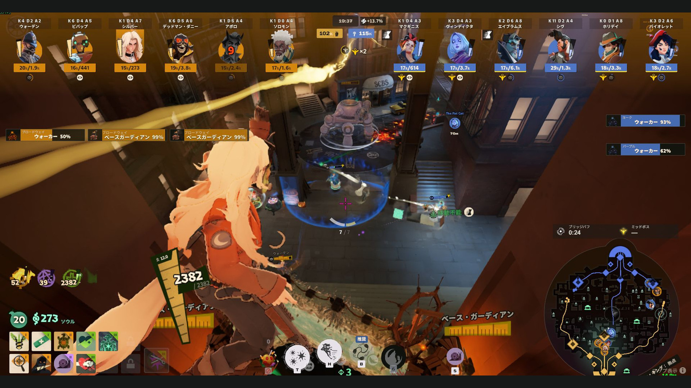

*Photos show HUD 0.6.0 with game build 6839 in Japanese. Full views are cropped; each close-up preserves a continuous region to show where the information appears. Game values and icons have not been altered.*

## What it adds to the standard view

### Purchases and ability changes

**Icon-and-name notifications** appear below each hero for purchases, detected sales and ability upgrades. Not every sale is guaranteed to be reported. Item accents distinguish Weapon, Vitality and Spirit. Upgrades show ◇1–3; confirmed unlocks use the game's unlock icon. Explain how a purchase changes the next fight without losing track of the player.

Notifications appear **below the corresponding hero portrait**.

**Item purchase**

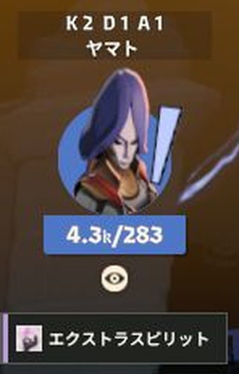

**Ability upgrade**

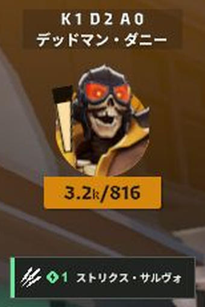

**Ability unlock**

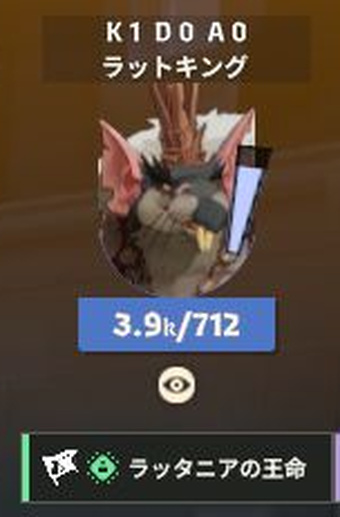

### Total souls and wallet

Each hero shows a name, K/D/A and **total souls / wallet**. For example, “4.1k / 909” means about 4,100 total souls and 909 in the wallet. Confirmed individual soul changes appear over this area. After five minutes, the central economy lead appears for the leading team only.

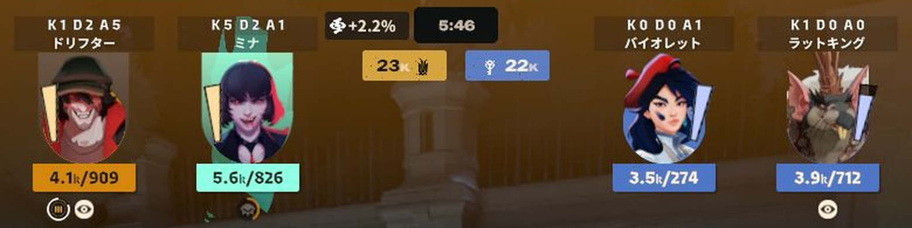

### Status application notifications

Supported stuns, slows, silence, curse, transformations, invulnerability and other supported effects appear as **icons without names beside the hero portrait**. The photo shows three notifications beside Violett.

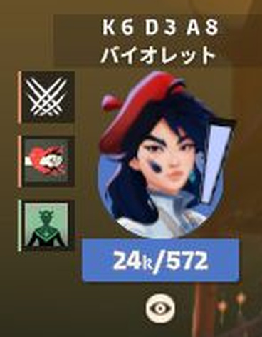

A new application is shown for about three seconds. Up to four appear separately; five or more overlap. These are not effect-duration timers. Coverage has not been verified for every hero or effect.

### Urn and Bridge Buff ownership

Separate from brief effect notifications, the HUD marks the Urn carrier above the hero portrait and up to two Bridge Buffs beside the ultimate icon below the economy area. A white outline around each Bridge Buff shows its remaining duration.

### Rejuvenator eligibility

A dedicated icon below the hero's economy area marks remaining Rejuvenator eligibility. The team's remaining count appears below the central timer.

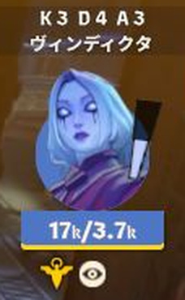

### Lane-grouped building HP

Damaged Guardian, Walker and Base Guardian HP is grouped **by lane**, retained for about five seconds after the last hit. Simultaneous entries pack horizontally. The two Base Guardians have separate HP entries. This is not a permanent list of every building.

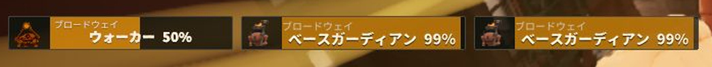

Shrines use two horizontal columns; Patron displays follow its phase. Mid Boss has a dedicated HP display.

### Timers above the minimap

Bridge Buff counts down to its **next scheduled appearance**. Mid Boss shows a respawn countdown or a spawned state when available from the game; an unavailable state shows “—”. The remaining duration of a collected Bridge Buff is shown by its white outline in the hero row.

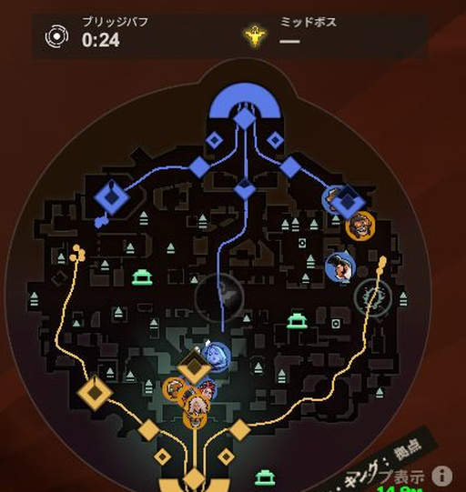

### Detailed view

Inventory is arranged in three columns, while top hero information and map timers remain visible. Follow the action in the normal view, then compare builds during a quieter moment.

## First setup

Requires Windows with Steam and Deadlock installed. The runnable ZIP includes its runtime; no separate Python, Node.js or .NET installation is needed.

1. Download the runnable ZIP from [Release](https://github.com/aominn/deadlock-spectator-hud-public/releases/tag/v0.6.0) and **extract all files**. Do not run from inside the ZIP.
2. Exit Deadlock and open **HudManager.exe** from the extracted folder.
3. Select **Deadlock/game/citadel**, then **Prepare**. Images are prepared from the game installed on that PC.
4. Choose **Enable HUD → Launch game**, then open spectating or a compatible replay.

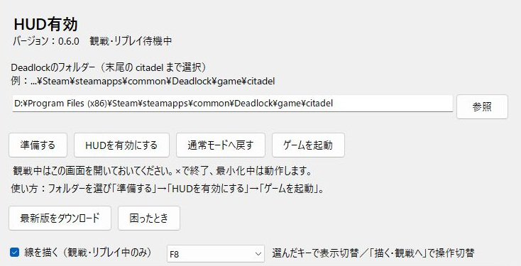

Keep the manager open while spectating. Minimizing keeps it running; **closing with × stops its helper processes**. Allow preparation time when joining late or analyzing a replay for the first time.

## Draw on the screen

Enable **Draw lines (spectating/replays only)** in the manager and press **F8** in the game, or the key you selected.

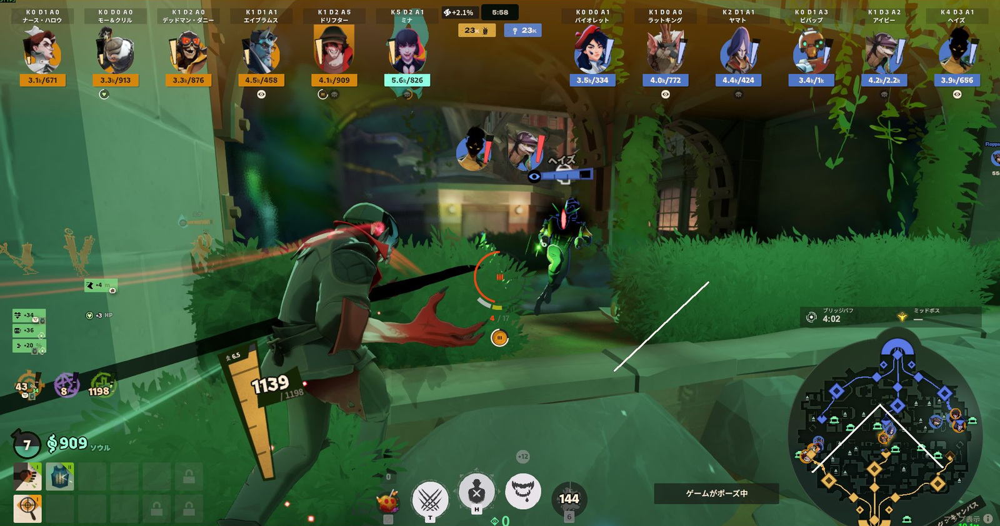

- Choose four colors, thin/thick strokes and pen/arrow tools. Undo and Clear are available on the toolbar.
- **Watch or Esc** returns to game controls while keeping the lines; **Draw** resumes drawing. F8 toggles toolbar visibility.
- Draw anywhere, including over the minimap. Lines are fixed to screen coordinates and do not follow the camera.
- Lines survive switching to another window. Seeking, changing matches, restoring normal mode or exiting the tool clears them.
- Enable the drawing checkbox each time you open the manager. Drawing can reduce FPS.

[Drawing details](docs/DRAWING.txt)

## Restore normal mode and update

**Before returning to regular play**: Exit Deadlock, then select **Restore normal mode** in the manager.

**Update**: Close the game and manager, extract the latest ZIP into a new folder, and open its HudManager.exe. No manual individual-file replacement is needed.

**Troubleshooting**: After exiting the game, **Troubleshooting** provides file checks, image refresh and rollback to a retained previous version. [Installation and recovery](docs/INSTALL.txt)

## Languages and verification scope

The manager and drawing toolbar follow the **Windows display language**. Additional in-game text follows the **Deadlock language**. Each uses Japanese for Japanese and English otherwise. The photos here are Japanese.

On November 1, 2026, three recent replays were downloaded and confirmed to start with 0.6.0. Photos come from two of them. Seeking into the middle of one replay terminated the game, so the long-seek limitation remains.

A user has confirmed basic installation, asset preparation, spectating/replays, normal restoration, Japanese/English and × shutdown on another PC. Exhaustive testing of all heroes/effects, all live features, OBS capture methods and exclusive fullscreen is incomplete. [Current limitations](docs/STATUS.txt)

Report problems through [GitHub Issues](https://github.com/aominn/deadlock-spectator-hud-public/issues) with HUD version, game language, spectating/replay and reproduction steps. Do not post authentication data in logs. A [contact form](https://aominn.jp/form/) is also available.

## Unofficial tool and licenses

Not developed, approved or supported by Valve. Intended for spectating and replays, not regular gameplay.

Game icons, native UI originals, game fonts and a generated MOD are not included in the runnable ZIP. They are prepared from the user's installed game. Documentation photos are illustrations; game-content rights remain with their respective owners.

Authored code uses [MIT](LICENSE). See [third-party notices](THIRD_PARTY_NOTICES.txt) and [photo provenance](docs/images/README.txt) for other components and documentation images.

[Changelog](docs/CHANGELOG.txt) · [Build](docs/BUILD.txt) · [Distribution checks](docs/PORTABLE.txt) · [Local assets](docs/LOCAL-ASSETS.txt)
