# Deadlock Spectator HUD

An unofficial Deadlock spectator HUD for tournament broadcasts and replay analysis. Show team names and series scores alongside damage stats and the soul lead. Use lines and arrows to explain how a play unfolded.

[日本語](README.md) · Windows 10/11 x64

This combines a MOD that changes the in-game display with a companion manager. **Use it for spectating and replays. Before regular play, exit the game and select Restore normal mode.** It is not developed or approved by Valve.

[Setup](#first-setup) · [Tournament setup](#show-team-names-logos-and-bans) · [On-screen drawing](#draw-on-the-screen) · [Restore and update](#restore-normal-mode-and-update) · [Coverage](docs/STATUS.txt)

**Download the runnable ZIP from [GitHub Releases](https://github.com/aominn/deadlock-spectator-hud-public/releases).** This guide covers version 0.7.10.

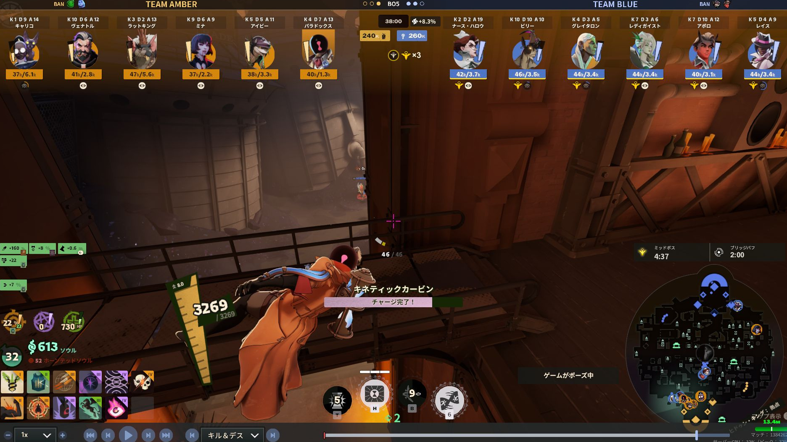

*These are actual game and manager screenshots, shown in Japanese. Close-ups preserve portrait or location context. See [photo provenance](docs/images/README.txt).*

## HUD changes

### Purchases and ability changes

**Icon-and-name notifications** appear below each hero for purchases, detected sales and ability upgrades. Not every sale is guaranteed to be reported. Item accents distinguish Weapon, Vitality and Spirit. Upgrades show ◇1–3; confirmed unlocks use the game's unlock icon. Explain how a purchase changes the next fight without losing track of the player.

Notifications appear **below the corresponding hero portrait**.

**Item purchase**

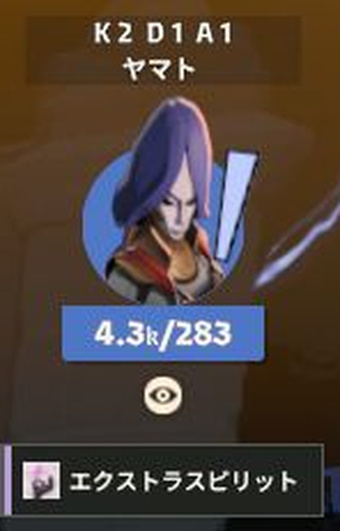

**Ability upgrade**

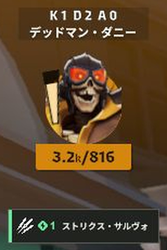

**Ability unlock**

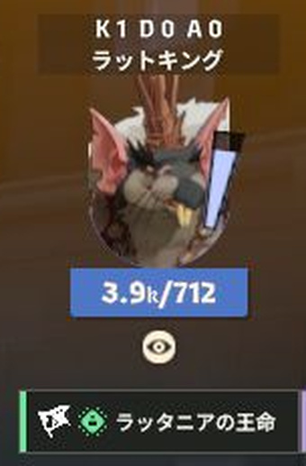

### Total souls and wallet

Each hero shows a name, K/D/A and **total souls / wallet**. Names and K/D/A stay on the same rows during kill-streak animations. For example, “4.1k / 909” means about 4,100 total souls and 909 in the wallet. Confirmed individual soul changes appear over this area. Both team totals appear below the match clock at the top center. After five minutes, the percentage lead appears beside the clock on the leading team's side, calculated relative to the opposing team's total.

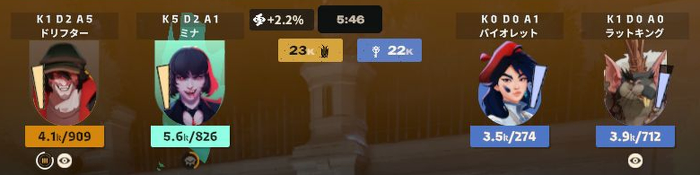

### Compare inventories in the detailed view

Open the **scoreboard/detailed view using your configured game key** to see each hero's inventory in **three columns**. Compare builds during a quieter moment after a fight. Top hero information and timers above the minimap remain visible.

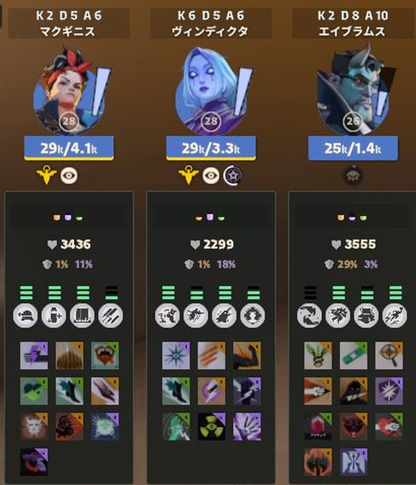

### Status application notifications

Supported stuns, slows, silence, curse, transformations, invulnerability and other supported effects appear as **icons without names beside the hero portrait**. The photo shows three notifications beside Violet.

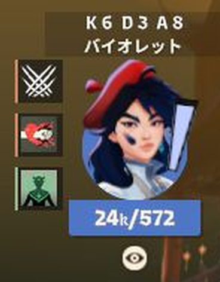

A new application is shown for about three seconds. Up to four appear separately; five or more overlap. These are not effect-duration timers; only effects supported by the HUD are shown.

### Urn and Bridge Buff ownership

Separate from brief effect notifications, the HUD marks the Urn carrier above the hero portrait and up to two Bridge Buffs beside the ultimate icon below the economy area. A white outline around each Bridge Buff shows its remaining duration. In the Silver photo, the two icons on the left are the Bridge Buffs.

| Urn carrier | Two Bridge Buffs |
| :---: | :---: |
| 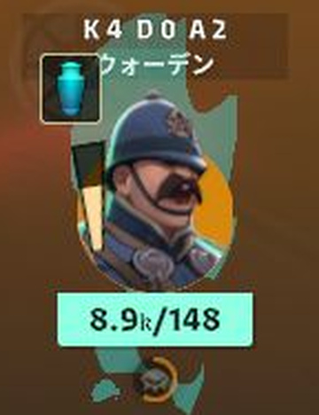 | 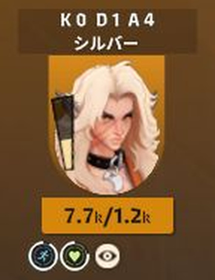 |

### Rejuvenator eligibility

A **yellow icon below a hero's economy area** marks that hero's Rejuvenator eligibility. The team's remaining uses appear as a count such as “×3” **below that team's total net worth** at the top of the screen.

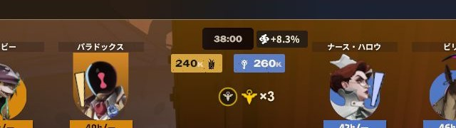

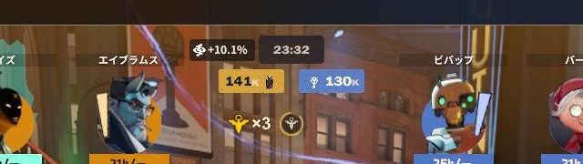

### Lane-grouped building HP

Damaged Guardian, Walker and Base Guardian HP appears **on the left and right of the screen below the hero row**, retained for about five seconds after the last hit. Simultaneous entries **in the same lane** pack horizontally. The two Base Guardians have separate HP entries. This is not a permanent list of every building.

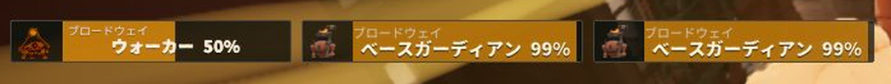

The two Shrines are shown side by side; Patron displays follow its phase. Mid Boss has a dedicated HP display.

### Timers above the minimap

Bridge Buff counts down to its **next scheduled appearance**. Mid Boss shows a respawn countdown or a spawned state when available from the game; an unavailable state shows “—”. The remaining duration of a collected Bridge Buff is shown by its white outline in the hero row.

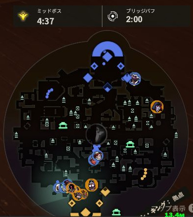

### Compare damage and see how the soul lead changed

The default shortcuts are **F9** for Damage Dealt (damage dealt to other heroes) and **F10** for Soul Lead. Each panel shows a snapshot of the moment you open it. Press the same key to close it, or the other key to switch panels. Reopen a panel to see the latest values. Seeking in a replay refreshes the snapshot at the new position. In live matches, the graph covers the portion recorded since you joined. Saved bindings carry over. Change them under **Settings → Key bindings**.

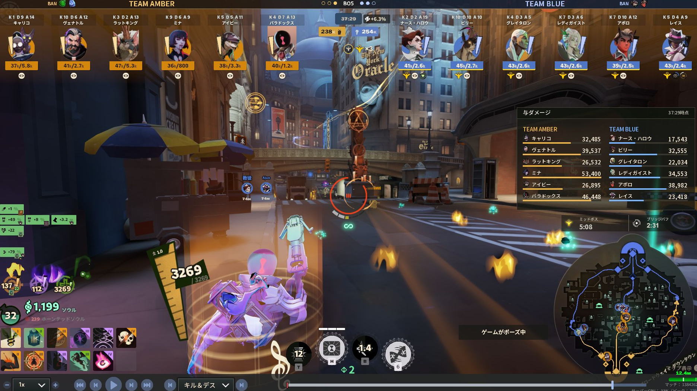

The table compares how much damage each hero has dealt to enemy heroes so far.

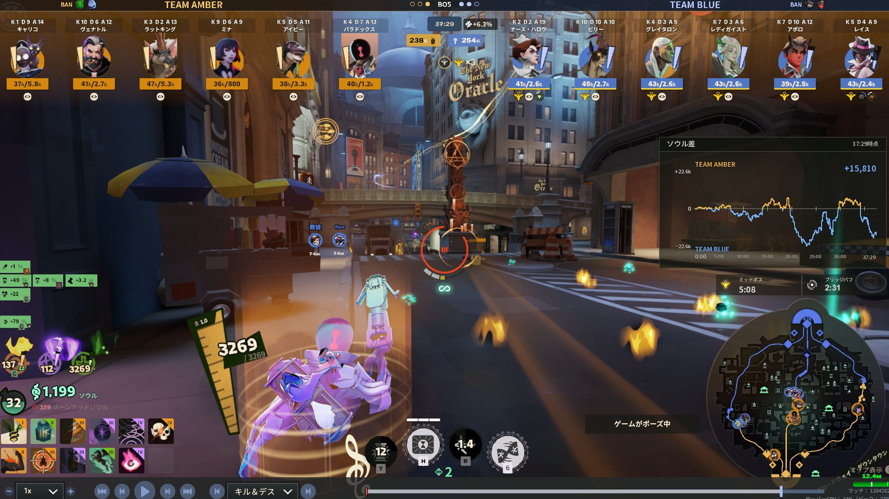

The line color identifies the leading team. Its distance from zero shows the gap in net worth.

## First setup

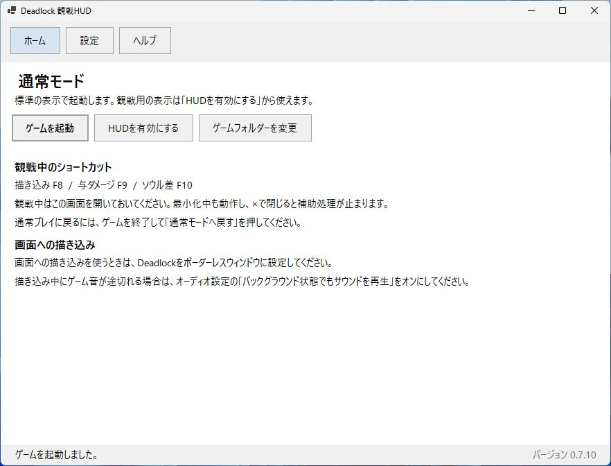

**Use with other MODs has not been tested. Display or functional problems caused by MOD conflicts are outside the scope of support.**

Requires Windows 10/11 x64, with Steam and Deadlock installed. The runnable ZIP includes its runtime; no separate Python, Node.js or .NET installation is needed.

1. Get the runnable ZIP from [Releases](https://github.com/aominn/deadlock-spectator-hud-public/releases) or the distribution link you received, then **extract all files**.
2. Exit Deadlock and open **HudManager.exe** from the extracted folder.
3. On **Home**, confirm **Deadlock/game/citadel**, then choose **Prepare assets**. Images are prepared from the game installed on that PC.
4. On Home, choose **Enable HUD → Launch game**, then open spectating or a compatible replay.

After setup, use **Change game folder** on Home to select a different location.

Older replays may be incompatible with the current game. Some long seeks can exit the game. Leave live spectating before opening a replay.

Keep the manager open while spectating. Minimizing keeps it running; **closing with × stops its helper processes**. Closing alone does not restore normal mode. Allow preparation time when joining late or analyzing a replay for the first time.

## Show team names, logos and bans

With the game closed, select **Save all three settings** to save changes to Display, Key bindings, and Teams & tournament together. The drawing FPS command takes effect when you run it in the game.

Open **Settings → Teams & tournament** before launching the game. **Left team** and **Right team** refer to their positions on the spectator HUD. Set the name, PNG or JPEG logo, and visibility for both teams on this page. Choose Small, Standard, or Large for both team headings.

Use **Choose bans** to manually select up to six heroes banned by each team. Save to show their icons above that team's roster in spectating and replays. Selections carry over to the next match. Use **Clear bans** for each side and save before setting up the next match. Teams with no selections have no BAN row.

In **Teams & tournament** before launch, select BO3 or BO5 and enter each side’s wins to show the series score in the center of the full-width tournament header. The full-width header, match clock, and team net worth stay in the same positions with the series score turned off.

The strip above the minimap shows Mid Boss on the left and Bridge Buff on the right. The Mid Boss countdown continues after a Rejuvenator pickup if the HUD has received the timer. A dash appears when the time is unavailable.

See the [test record](docs/STATUS.txt) for results by version and resolution.

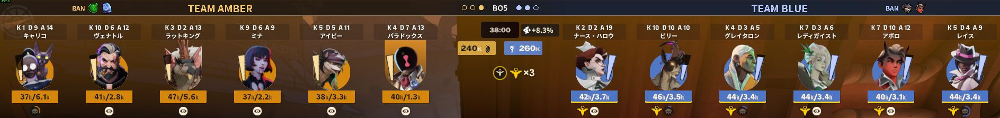

Team names, logos and BAN assignments are examples.

## Draw on the screen

Circle a location or draw an arrow to explain a movement: **draw directly on the spectator screen with the mouse**, including over the minimap.

- Set Deadlock to **Borderless Window** to draw on screen.
- If game audio stops while drawing, turn on **Play sound in background** in Deadlock’s audio settings.

To hide the playback bar at the bottom of a replay, open the Esc menu and select **Hide replay bar** under **Spectator HUD** on the right. Hiding it moves the abilities, inventory, souls and stats down to their live spectator positions. Select **Show replay bar** in the same menu to restore the bar and replay layout.

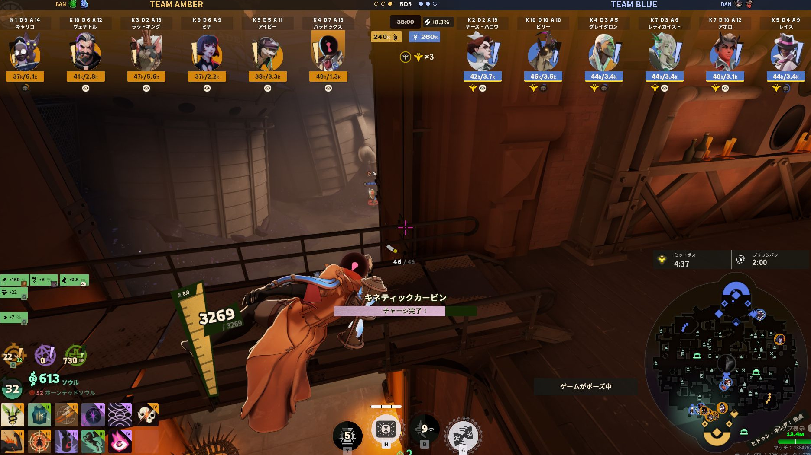

In the manager, open **Settings → Key bindings**, turn on **Enable drawing (spectating and replays only)** and save. Press the **assigned key (default: F8)** while spectating or watching a replay. You can change the key in the manager.

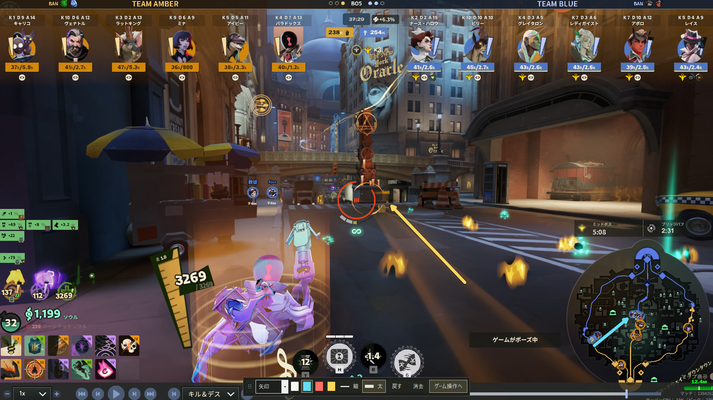

- Choose four colors, thin/thick strokes and pen/arrow tools. Undo and Clear are available on the toolbar.
- **Back to game or Esc** returns to game controls while keeping the drawings and toolbar. Press the **assigned key** or select **Draw** to resume.
- Press the **same key while drawing** to hide the toolbar and return to game controls. Press it again to open the toolbar and start drawing. Your drawings stay on screen.
- Draw anywhere, including over the minimap. Lines are fixed to screen coordinates and do not follow the camera.
- Lines survive switching to another window. Seeking, changing matches, restoring normal mode or exiting the tool clears them.

[Drawing details (Japanese)](docs/DRAWING.txt)

### If FPS drops while drawing (optional)

FPS may drop while the drawing tool has focus. In HudManager, open **Settings → Drawing on screen**, copy a command, and paste and run it in Deadlock’s developer console. In the Hideout, while spectating, or while watching a replay, the **Spectator HUD** panel on the right of the Esc menu also offers **Reduce drawing FPS drops** and **Restore default**. Each option shows the command it runs.

- **Reduce drawing FPS drops** — `engine_no_focus_sleep 0`
- **Restore default** — `engine_no_focus_sleep 20`

With the value set to `0`, Deadlock may use more resources whenever it is out of focus. The setting can persist after the game exits, so choose **Restore default (20)** after your stream or event. If you use a custom value, check it with `engine_no_focus_sleep` before changing it and enter that value again when you are done.

**If the value is still `0` after a forced exit**, reopen Deadlock and enter `engine_no_focus_sleep 20` or your previous custom value in the console. Enter `engine_no_focus_sleep` again to check the result.

## Restore normal mode and update

**Before returning to regular play**: Exit Deadlock, then select **Restore normal mode** in the manager. To spectate with the HUD again, exit the game and choose **Enable HUD → Launch game**.

If a game update breaks the display, restore normal mode and wait for a compatible HUD release.

**Update**: Get the latest runnable ZIP through **Help → Download latest** in the manager or [GitHub Releases](https://github.com/aominn/deadlock-spectator-hud-public/releases). Close the game and manager, extract everything into a new folder, and open its HudManager.exe. Follow the manager's prompts, enable the HUD and launch the game. No manual individual-file replacement is needed.

**Help**: After exiting the game, **Help** provides file checks, image refresh and rollback to a retained previous version. [Installation and recovery](docs/INSTALL.en.txt)

## Display languages

The manager and drawing toolbar follow the **Windows display language**. Additional in-game text follows the **Deadlock language**. Each uses Japanese for Japanese and English otherwise. The photos here are Japanese.

## Problems and contact

Report problems through [GitHub Issues](https://github.com/aominn/deadlock-spectator-hud-public/issues) with HUD version, game language, spectating/replay and reproduction steps. Do not post authentication data in logs. A [contact form](https://aominn.jp/form/) is also available.

## Unofficial tool and licenses

Not developed, approved or supported by Valve. Intended for spectating and replays, not regular gameplay.

This tool is developed and refined using AI tools, including Codex and Claude.

Game icons, native UI originals, game fonts and a generated MOD are not included in the runnable ZIP. They are prepared from the user's installed game. Documentation photos are illustrations; game-content rights remain with their respective owners.

Authored code uses [MIT](LICENSE). See [third-party notices](THIRD_PARTY_NOTICES.txt) and [photo provenance](docs/images/README.txt) for other components and documentation images.

[Changelog](docs/CHANGELOG.txt) · [Build](docs/BUILD.txt) · [Distribution checks](docs/PORTABLE.txt) · [Local assets](docs/LOCAL-ASSETS.txt)
