# Deadlock Spectator HUD

Deadlockのコミュニティ大会配信や、リプレイを使った試合解説に向けた非公式HUDです。観戦画面にチーム名やシリーズのスコアを載せ、与ダメージやソウル差を映せます。リプレイでは、画面に線や矢印を引いて選手の動きを説明できます。

[English](README.en.md) · Windows 10・11 x64

ゲーム内の表示を変更するMODと管理ツールを組み合わせています。**観戦・リプレイ用です。通常プレイの前は、ゲームを終了して「通常モードへ戻す」を押してください。** Valveが開発・承認したものではありません。

[導入手順](#最初の使い方) · [大会配信の設定](#チーム名ロゴとbanを表示する) · [描き込み](#画面への描き込み) · [通常復帰・更新](#通常の表示に戻す更新する) · [対応範囲（英語）](docs/STATUS.txt)

**実行用ZIPは [GitHub Releases](https://github.com/aominn/deadlock-spectator-hud-public/releases) から。** このREADMEは0.7.10の使い方を案内します。

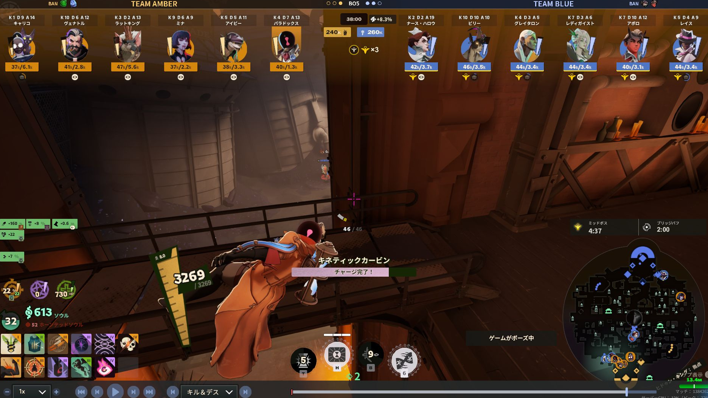

*掲載画像は実際のゲーム画面と管理画面です。拡大写真はキャラや表示位置が分かる範囲を切り出しています。[写真の出典](docs/images/README.txt)*

## 表示をどう変えるか

### 購入とアビリティの変化を追う

キャラ欄の下へ、**アイコン＋名前**で購入・検出できた売却・アビリティ強化を通知します。すべての売却を通知できるとは限りません。アイテムは武器・バイタリティ・スピリットの色で識別でき、強化は◇1〜3、確認できた解放は解放アイコンで表します。次の集団戦に向けた買い物や強化を追えます。

通知は、それぞれの**キャラアイコンの下**に出ます。

**アイテム購入**

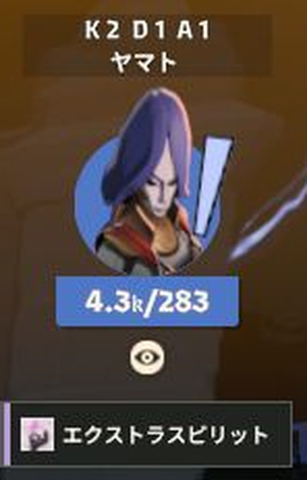

**アビリティ強化**

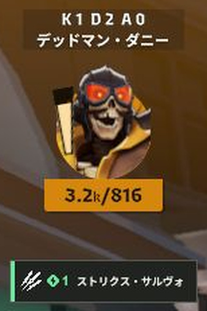

**アビリティの解放**

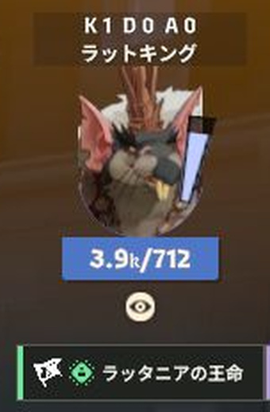

### 総資産と手持ちを分けて見る

各キャラに名前とK/D/A、**総資産／手持ち**を表示します。連続キル演出中も名前とK/D/Aは同じ高さに表示されます。「4.1k／909」なら総資産は約4,100、手持ちは909ソウルです。取得できた本人の増減を金額欄に重ねて通知します。画面上部中央の試合時間の下には両チームの総資産を表示します。開始5分後からは、試合時間の横（優勢チーム側）に資産差を％で表示します。相手チームの総資産が割合の基準です。

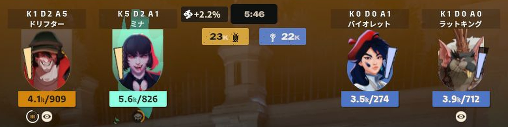

### 詳細画面で所持アイテムを見比べる

ゲームで設定しているキーで**スコアボード（詳細表示）を開くと**、各キャラの所持アイテムを**横3列**に整理して表示します。集団戦のあとなど、画面が落ち着いたところで構成を見比べられます。上部のキャラ情報とミニマップ上のタイマーも残ります。

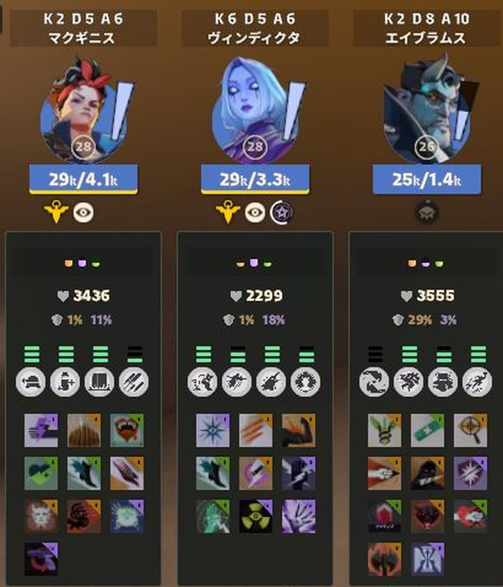

### 効果が付いた瞬間を知らせる

対応するスタン・スロー・サイレンス・カース・変身・無敵などを、**キャラアイコンの脇に、名前なしのアイコン**で通知します。写真ではバイオレットの横に3つ並んでいます。

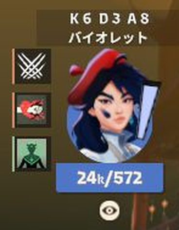

新たな付与を約3秒表示し、4つまでは並べ、5つ以上は重ねます。効果の残り時間ゲージではありません。表示するのは、HUDが対応している効果です。

### 壺・ブリッジバフの所持者を見る

短い効果通知とは別に、壺は所持者のキャラアイコン上側に表示します。ブリッジバフは、金額欄の下のアルティメットアイコン横に最大2個並び、白い縁取りが残り時間を示します。写真のシルバーでは、左の2つがブリッジバフです。

| 壺を所持 | ブリッジバフを2個所持 |
| :---: | :---: |
| 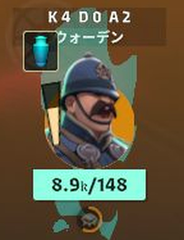 | 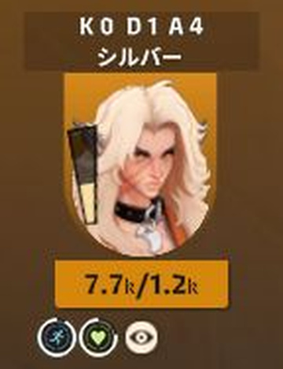 |

### リジュベネーターの使用権を見る

使える状態のキャラには、**各キャラの金額欄の下に黄色いアイコン**が出ます。チーム全体で使える残り回数は、**画面上部中央にある各チームの総資産欄の下**に「×3」のように表示します。

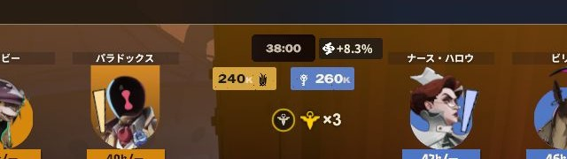

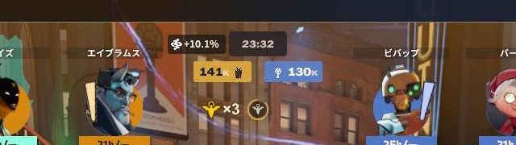

### レーンごとの建物HP

ガーディアン・ウォーカー・ベースガーディアンは、被弾すると**キャラ欄より下の画面左右**にHPを表示し、最後の被弾から約5秒残します。**同じレーンで同時に出る建物だけ**横に詰めて並べ、ベースガーディアン2体は別々のHPを表示します。常に全建物を一覧表示する機能ではありません。

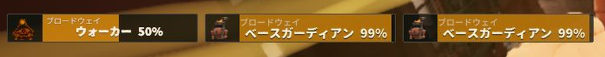

シュラインは横2列、パトロンは形態に応じた表示。ミッドボスにも専用のHP表示があります。

### ミニマップ上のタイマー

ブリッジバフは**次の出現予定まで**、ミッドボスはゲームから取得できた再出現カウントダウンや「出現中」を表示します。HUDが情報を得られなければ「—」になります。取ったブリッジバフの残り時間はキャラ欄の白い縁取りで示します。

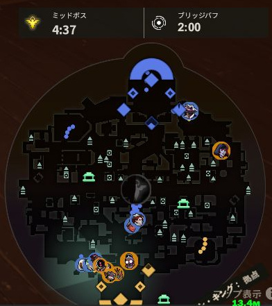

### 与ダメージとソウル差を確認する

初期キーは **F9** が与ダメージ（他のヒーローに与えたダメージ）、**F10** がソウル差です。表とグラフは開いた時点の表示で固定されます。同じキーで閉じ、開き直すと最新の値が表示されます。もう一方のキーを押すと表示が切り替わり、リプレイをシークしたときは移動先のデータを取り直します。ライブ観戦のグラフには、観戦を始めてから取得した区間が表示されます。保存済みの割り当ては引き継ぎます。キーを変えるには「設定」→「キー設定」を開きます。

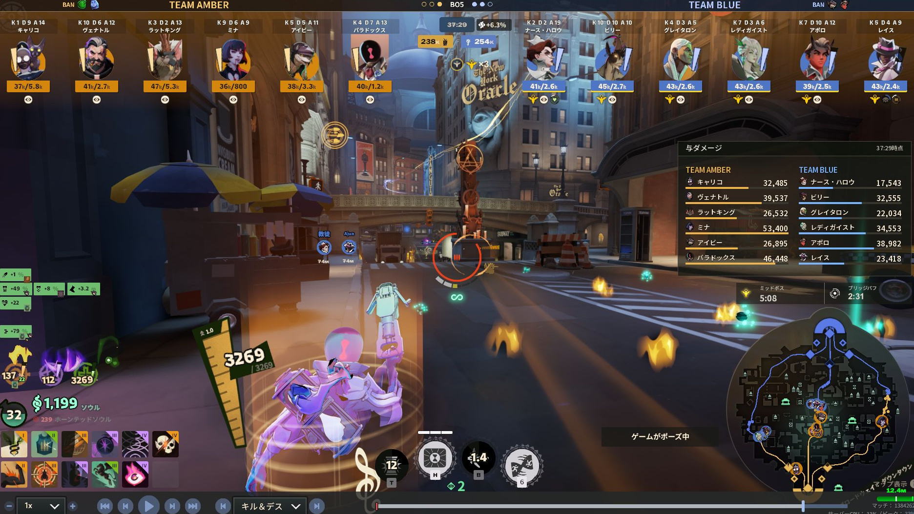

右側の表に、各ヒーローが試合中に相手ヒーローへ与えたダメージを表示します。

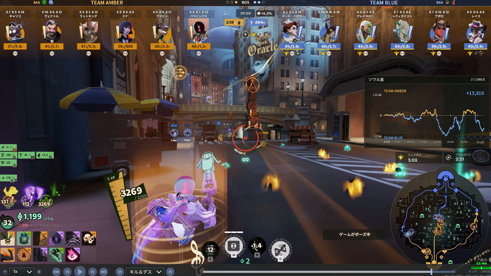

グラフの色で優勢なチーム、中央の0からの距離で総資産の差が分かります。

## 最初の使い方

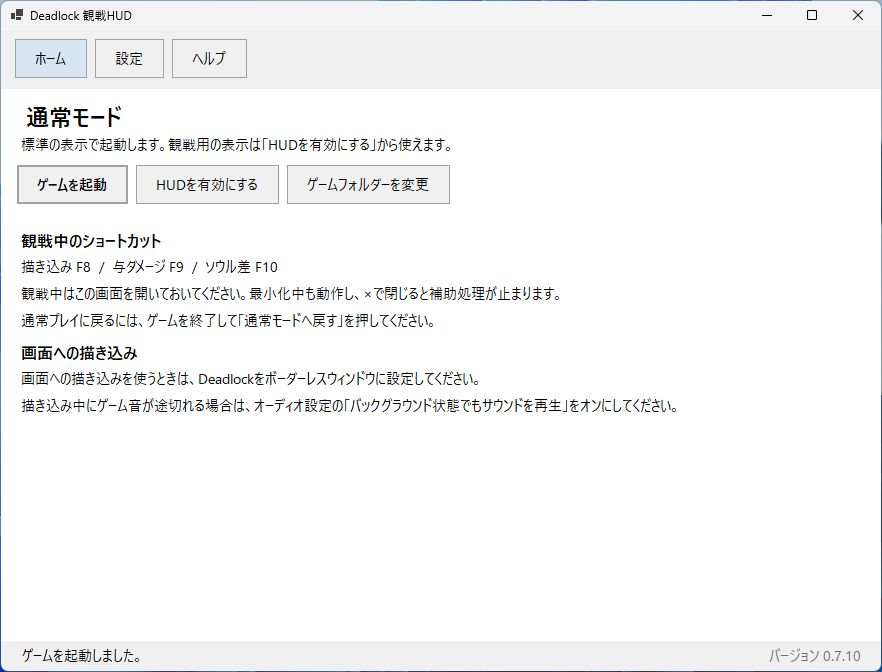

**他のMODとの併用は動作未確認です。競合による表示崩れや不具合はサポート対象外です。**

Windows 10・11の64bit版と、Steam・Deadlockが必要です。実行環境が含まれるため、Python・Node.js・.NETの別途導入は不要です。

1. [Releases](https://github.com/aominn/deadlock-spectator-hud-public/releases)または案内された配布先から実行用ZIPを入手し、**すべて展開**します。
2. Deadlockを終了し、展開先の **HudManager.exe** を開きます。
3. **ホーム**で **Deadlock/game/citadel** フォルダーを確認し、 **「素材を準備する」** を押します。画像はそのPCにインストールしたゲームから用意します。
4. ホームの **「HUDを有効にする」→「ゲームを起動」** から、観戦・対応するリプレイを開きます。

準備後に場所を変えるときは、ホームの **「ゲームフォルダーを変更」** から設定できます。

古いリプレイは現行ゲームと互換性がない場合があります。長いシークでゲームが終了する場合もあります。ライブ観戦からリプレイへ切り替えるときは、観戦を退出してから開いてください。

観戦中は管理画面を開いておきます。最小化中は継続し、**×で閉じると補助処理も終了**します。×で閉じるだけでは通常モードには戻りません。途中参加や初回解析では準備を待ってください。

## チーム名・ロゴとBANを表示する

設定画面の **「3つの設定をまとめて保存」** で、表示・キー設定・チーム／大会の変更を一度に保存できます。ゲームを終了してから保存してください。描画中のFPSに関する設定は、ゲーム内で切り替えます。

ゲームを起動する前に、管理ツールの **「設定」→「チーム・大会」** を開きます。「左チーム」「右チーム」は観戦画面での位置です。名前、PNG／JPEGのロゴ、表示のオン・オフは同じ画面で設定します。見出しの大きさを「小」「標準」「大」から選べます。左右で共通の設定です。

**「BANを選ぶ」** では、そのチームがBANしたヒーローを最大6体まで手入力します。保存すると、選んだヒーローのアイコンが観戦・リプレイ画面上部の該当チーム側に出ます。BANは試合が変わっても設定が残ります。次の試合の前に各チームの **「BANをクリア」** を押し、保存してください。空欄のチームにはBAN表示が出ません。

起動前に「設定」→「チーム・大会」で大会ヘッダーをBO3またはBO5に設定し、左右の取得本数を入力できます。全幅ヘッダーは共通で、BO3／BO5を選ぶと上段中央に形式と取得本数が表示されます。試合タイマーとチーム資産の位置は固定です。

ミニマップ上の細いタイマーは左がミッドボス、右がブリッジバフです。ミッドボスの残り時間を取得済みなら、リジュベネーター取得後も表示を続けます。観戦を途中から始め、ゲームから残り時間を受け取れていない場合は「—」を表示します。

解像度ごとの確認結果は[動作確認の記録](docs/STATUS.txt)にまとめています。

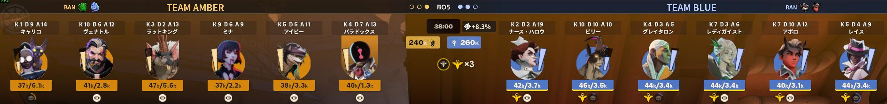

チーム名・ロゴとBANの左右の割り当ては表示例です。

## 画面への描き込み

注目してほしい場所を丸で囲んだり、移動する方向を矢印で示したり、**観戦画面にマウスで直接描き込んで解説**できます。ミニマップ上にも描けます。

- 画面への描き込みを使うときは、Deadlockを **ボーダーレスウィンドウ** に設定してください。
- 描き込み中にゲーム音が途切れる場合は、オーディオ設定の **「バックグラウンド状態でもサウンドを再生」** をオンにしてください。

リプレイの画面下にあるシークバーを隠すには、Escメニュー右側の **「観戦HUD」→「シークバーを隠す」** を選びます。下のアビリティ欄と左下のアイテム・所持ソウル・ステータス欄は、ライブ観戦と同じ高さに下がります。同じ場所の **「シークバーを表示」** で、バーとHUDの位置が戻ります。

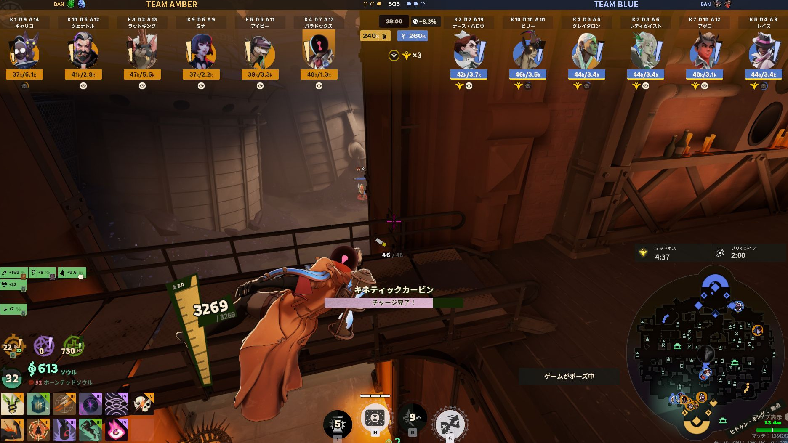

管理画面の **「設定」→「キー設定」** で **「描き込みを有効にする（観戦・リプレイ中のみ）」** をオンにして保存し、観戦・リプレイ画面で **割り当てたキー（初期値 F8）** を押します。キーは管理画面で変更できます。

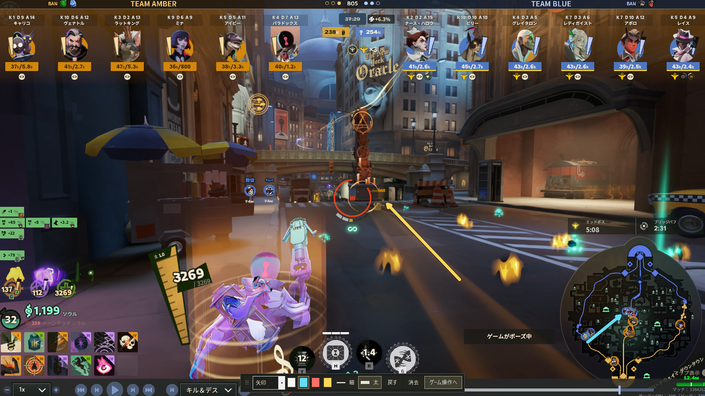

- ツールバーで4色・細い線／太い線・ペン／矢印を選べます。「戻す」「消去」も使えます。
- **「ゲーム操作へ」またはEsc** で線とツールバーを残してゲーム操作へ戻ります。**割り当てたキーまたは「描く」** で描き込みを再開できます。
- 描き込み中に **同じキー** を押すと、ツールバーを隠してゲーム操作へ戻ります。非表示のときは同じキーで描き込みを開始します。どちらの切替でも線は残ります。
- 画面全体へ描けるのでミニマップ上にも描けます。線は画面上の位置に固定され、カメラには追従しません。
- 別ウィンドウへの切替では線を保持し、シーク・別試合・通常モード復帰・ツール終了では消去します。

[描画の詳しい説明](docs/DRAWING.txt)

### 描画中にFPSが下がるとき（任意）

描画ツールに入力が移っている間は、ゲームのFPSが下がる場合があります。必要なときは管理ツールの **「設定」→「画面への描き込み」** でコマンドをコピーし、Deadlockの開発者コンソールに貼り付けて実行できます。隠れ家（ロビー）や観戦・リプレイ中は、Escメニュー右側の**「観戦HUD」**からも「描き込み中のFPS低下を抑える」「標準に戻す」を選べます。各項目の下には実行するコマンドを表示します。

- **描き込み中のFPS低下を抑える** — `engine_no_focus_sleep 0`
- **標準に戻す** — `engine_no_focus_sleep 20`

`0` の間は、別アプリに切り替えたときにもゲームの負荷が上がる場合があります。値はゲーム終了後にも残るため、配信や大会が終わったら **「標準に戻す」（20）** を選んでください。独自の値を使う場合は、変更前にコンソールで `engine_no_focus_sleep` を確認し、終わったら控えた値をコンソールで指定してください。

**強制終了後に `0` が残ったとき**は、Deadlockを開き直してコンソールから `engine_no_focus_sleep 20`、または元の独自値を入力します。入力後に `engine_no_focus_sleep` で値を確認できます。

## 通常の表示に戻す・更新する

**通常プレイへ戻るとき**：Deadlockを終了し、管理画面の **「通常モードへ戻す」** を押します。再びHUDで観戦するときは、ゲームを終了して「HUDを有効にする」→「ゲームを起動」を選びます。

ゲーム更新後に表示が崩れた場合は通常モードへ戻し、対応版をお待ちください。

**更新**：管理画面の「ヘルプ」→「最新版をダウンロード」または[GitHub Releases](https://github.com/aominn/deadlock-spectator-hud-public/releases)から新しい実行用ZIPを入手します。ゲームと管理画面を閉じ、最新版ZIPを新しいフォルダーへすべて展開。その中のHudManager.exeを開き、管理画面の案内に従ってHUDを有効にし、ゲームを起動します。ファイルを個別に差し替える必要はありません。

**困ったとき**：ゲームを終了して **「ヘルプ」→「困ったとき」** からファイル確認・画像の読み直し・保持された前版への復帰を行えます。[導入と復旧](docs/INSTALL.txt)

## 表示言語

管理画面・描画ツールは **Windowsの表示言語**、ゲーム内の追加表示は **Deadlockの言語** に従います。それぞれ日本語なら日本語、それ以外は英語です。写真は日本語環境です。

## 不具合・お問い合わせ

不具合は[GitHub Issues](https://github.com/aominn/deadlock-spectator-hud-public/issues)へ、HUDの版、ゲームの言語、観戦／リプレイ、再現手順を添えてください。認証情報を含むログは公開しないでください。GitHubを使わない場合は[お問い合わせ](https://aominn.jp/form/)からも連絡できます。

## 非公式ツール・ライセンス

Valveによる開発・承認・サポートを受けたツールではありません。通常プレイ用ではなく、観戦・リプレイ用です。

このツールは、Codex・ClaudeなどのAIを使って開発・調整しています。

ゲームのアイコン・標準UI原本・ゲーム字体・生成済みMODは実行用ZIPへ同梱せず、利用先のゲームから準備します。このREADMEの写真は説明用で、ゲーム素材の権利は各権利者に帰属します。

自作コードは[MIT](LICENSE)。第三者部品と説明用写真の扱いは[ライセンス案内](THIRD_PARTY_NOTICES.txt)を参照してください。写真の撮影条件・加工内容は[画像の来歴](docs/images/README.txt)に記載しています。

[変更履歴](docs/CHANGELOG.txt) · [開発手順](docs/BUILD.txt) · [配布検査](docs/PORTABLE.txt) · [素材準備](docs/LOCAL-ASSETS.txt)
