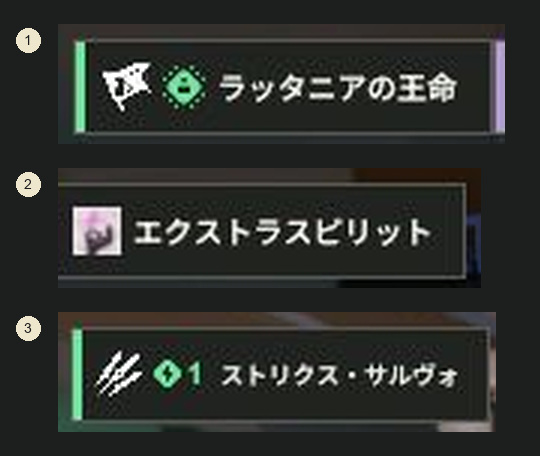
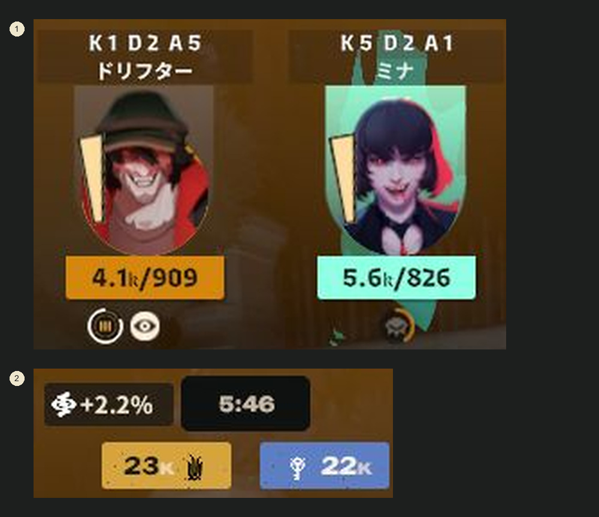
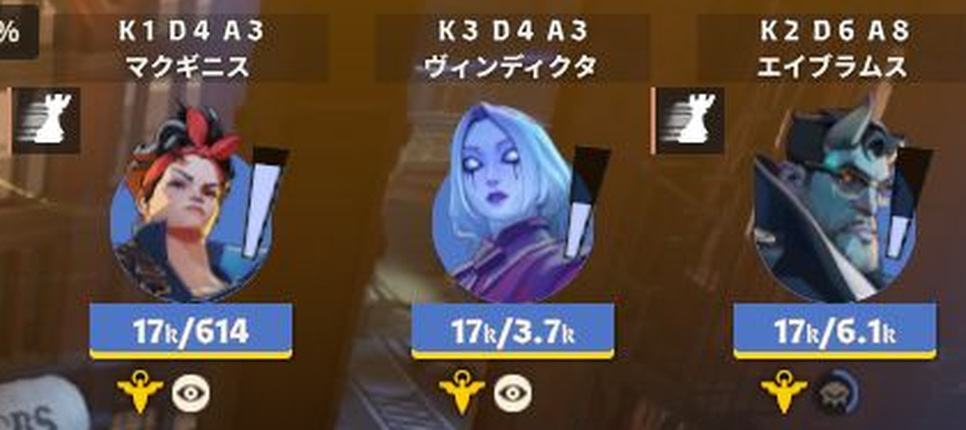
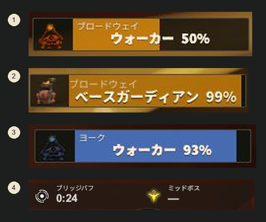
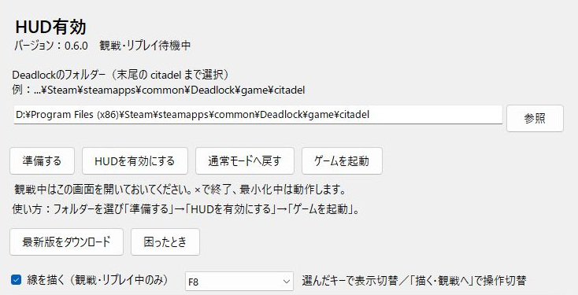
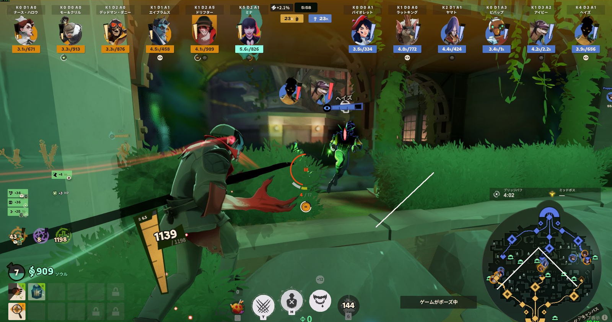

# Deadlock Spectator HUD

Deadlockの観戦・リプレイ向け非公式HUDです。**誰が何を買い、どんな効果を受け、どちらのチームが優勢か**を追いやすくし、画面に線を描いて解説できます。観戦、大会配信、試合後の振り返りを想定しています。

[English](README.en.md) · Windows 10・11 x64

**[0.6.0の実行用ZIPをダウンロード](https://github.com/aominn/deadlock-spectator-hud-public/releases/tag/v0.6.0)** — ReleaseのZIPをすべて展開してください。Codeの「Download ZIP」は開発用ソースです。

*以下はHUD 0.6.0／ゲームbuild 6839の実画面です。全体写真は周辺をトリミングし、拡大写真は説明用に切り出し・番号を追加しています。ゲーム内の数値やアイコンは加工していません。*

## 標準画面に加えてできること

### 購入とアビリティの変化を追う

キャラ欄の下へ、**アイコン＋名前**で購入・売却・アビリティ強化を通知します。アイテムは武器・バイタリティ・スピリットの色で識別でき、強化は◇1〜3、確認できた解放は解放アイコンで表します。集団戦の後に「今の買い物で何が変わったか」を説明できます。

*①解放、②購入、③アビリティ強化。別々の位置を拡大して並べた写真です。*

### 総資産と手持ち、所持状態を見る

各キャラに名前とK/D/A、**総資産／手持ち**を表示。確認できた本人のソウル増減を金額欄に重ね、中央にはチーム資産差を表示します。資産差の表示は開始5分後から、優勢側のみです。

壺の所持者、最大2個のブリッジバフと残り時間の白い縁取り、個別のリジュベネーター使用権とチームの残回数も表示します。写真にはリジュベネーター所持表示が写っています。

### 効果の付与をアイコンで知らせる

対応するスタン・スロー・サイレンス・カース・変身・無敵などを、キャラ周辺へ**名前なしのアイコン**で通知します。新たな付与を約3秒表示し、4つまでは並べ、5つ以上は重ねて表示します。これは効果の残り時間ゲージではありません。

*効果の付与通知と、所持しているバフの表示は別の仕組みです。全効果・全ヒーローの対応を保証するものではありません。*

### 建物とオブジェクトの状況を整理する

- ガーディアン・ウォーカー・ベースガーディアンの被弾HPを、**レーンごと**にまとめます。最後の被弾から約5秒残し、同じレーンで複数が表示されると横へ詰めます。ベースガーディアン2体は個別表示です。
- シュラインは横2列、パトロンは形態に応じた表示。ミッドボスには専用のHP表示を用意しています。
- マップ上にブリッジバフのカウントダウンとミッドボスの時間情報をまとめます。未取得の状態は写真のように「—」になる場合があります。
- 詳細表示では、所持アイテムを3列に整理し、上部のキャラ情報やマップ上のタイマーを残します。

*4つの番号は同じ実画面の別の位置です。常に全建物を一覧表示する機能ではありません。*

## 最初の使い方

SteamとDeadlockをインストールしたWindows PCで使います。実行環境が含まれるため、Python・Node.js・.NETの別途導入は不要です。

1. [Release](https://github.com/aominn/deadlock-spectator-hud-public/releases/tag/v0.6.0)の実行用ZIPを**すべて展開**します。ZIP内から直接起動しないでください。
2. Deadlockを終了し、展開先の **HudManager.exe** を開きます。
3. **Deadlock/game/citadel** フォルダーを指定し、**「準備する」**。画像はそのPCにインストールしたゲームから用意します。
4. **「HUDを有効にする」→「ゲームを起動」** から、観戦・対応するリプレイを開きます。

観戦中は管理画面を開いておきます。最小化中は継続し、**×で閉じると補助処理も終了**します。途中参加や初回解析では準備を待ってください。

## 画面に線を描く

管理画面の **「線を描く（観戦・リプレイ中のみ）」** にチェックし、ゲーム画面で **F8**。設定を変えている場合は選んだキーを使います。

- ツールバーで4色・細い線／太い線・ペン／矢印を選べます。「戻す」「消去」も使えます。
- **「観戦へ」またはEsc** で線を残してゲーム操作へ戻り、**「描く」** で再開します。F8はツールバーの表示切替です。
- 画面全体へ描けるのでミニマップ上にも描けます。線は画面上の位置に固定され、カメラには追従しません。
- 別ウィンドウへの切替では線を保持し、シーク・別試合・通常モード復帰・ツール終了では消去します。
- 描画チェックは管理画面を開くたびに設定します。描画中はFPSが下がる場合があります。

[描画の詳しい説明](docs/DRAWING.txt)

## 通常の表示に戻す・更新する

**通常復帰**：Deadlockを終了し、管理画面の **「通常モードへ戻す」** を押します。

**更新**：ゲームと管理画面を閉じ、最新版ZIPを新しいフォルダーへすべて展開。その中のHudManager.exeを開きます。ファイルを個別に差し替える必要はありません。

**困ったとき**：ゲームを終了して **「困ったとき」** からファイル確認・画像の読み直し・保持された前版への復帰を行えます。[導入と復旧](docs/INSTALL.txt)

## 言語と確認範囲

管理画面・描画ツールは **Windowsの表示言語**、ゲーム内の追加表示は **Deadlockの言語** に従います。それぞれ日本語なら日本語、それ以外は英語です。写真は日本語環境です。

2026年11月1日に最近のリプレイ3試合を取得し、0.6.0で再生開始を確認しました。掲載写真はそのうち2試合から撮影しています。1試合は中盤へのシークでゲームが終了したため、長いシークの制限は残しています。

別PCでの基本導入、素材準備、観戦・リプレイ、通常復帰、日英表示、×での終了は利用者の実機確認報告を得ています。OBSの各取得方式、排他フルスクリーン、全効果・全ヒーロー・ライブ全機能の網羅確認は完了していません。[現状と制限](docs/STATUS.txt)

不具合は[GitHub Issues](https://github.com/aominn/deadlock-spectator-hud-public/issues)へ、HUDの版、ゲームの言語、観戦／リプレイ、再現手順を添えてください。認証情報を含むログは公開しないでください。GitHubを使わない場合は[お問い合わせ](https://aominn.jp/form/)からも連絡できます。

## 非公式ツール・ライセンス

Valveによる開発・承認・サポートを受けたツールではありません。通常プレイ用ではなく、観戦・リプレイ用です。

ゲームのアイコン・標準UI原本・ゲーム字体・生成済みMODは実行用ZIPへ同梱せず、利用先のゲームから準備します。このREADMEの写真は説明用で、ゲーム素材の権利は各権利者に帰属します。

自作コードは[MIT](LICENSE)。第三者部品と説明用写真の扱いは[ライセンス案内](THIRD_PARTY_NOTICES.txt)を参照してください。写真の撮影条件・加工内容は[画像の来歴](docs/images/README.txt)に記載しています。

[変更履歴](docs/CHANGELOG.txt) · [開発手順](docs/BUILD.txt) · [配布検査](docs/PORTABLE.txt) · [素材準備](docs/LOCAL-ASSETS.txt)
