# Deadlock Spectator HUD

Deadlockの観戦・リプレイ向け非公式HUDです。**誰が何を買い、どんな効果を受け、どちらのチームが優勢か**を追いやすくし、画面に線を描いて解説できます。観戦、大会配信、試合後の振り返りを想定しています。

[English](README.en.md) · Windows 10・11 x64

ゲーム内の表示を変更するMODと管理ツールを組み合わせています。**観戦・リプレイ用です。通常プレイの前は、ゲームを終了して「通常モードへ戻す」を押してください。** Valveが開発・承認したものではありません。

[導入手順](#最初の使い方) · [通常復帰・更新](#通常の表示に戻す更新する) · [対応範囲（英語）](docs/STATUS.txt)

**[0.6.1の実行用ZIPをダウンロード](https://github.com/aominn/deadlock-spectator-hud-public/releases/tag/v0.6.1)** — ReleaseのZIPをすべて展開してください。Codeの「Download ZIP」は開発用ソースです。

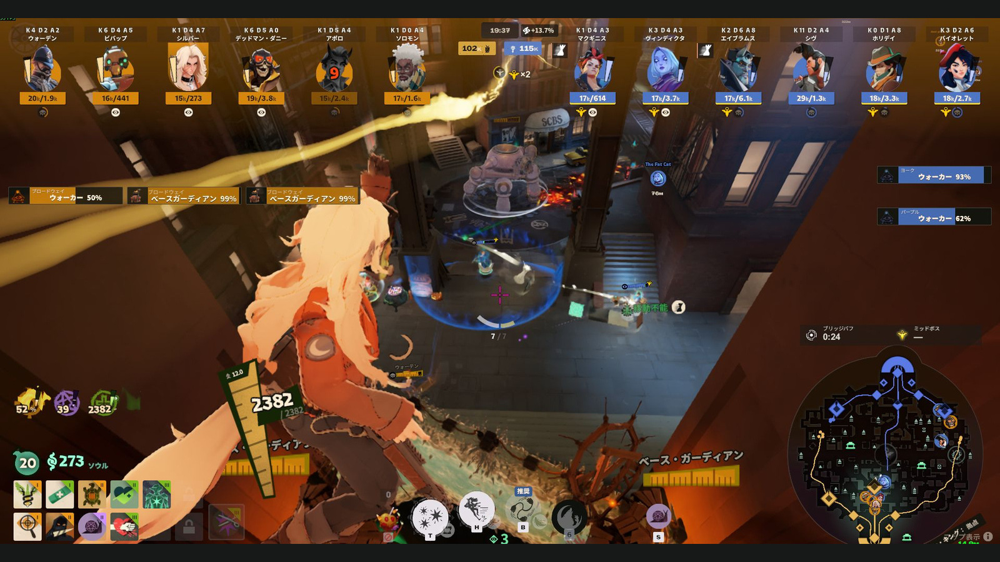

*掲載画像は実際のゲーム画面と管理画面です。拡大写真はキャラや表示位置が分かる範囲を切り出しています。[写真の出典](docs/images/README.txt)*

## 表示をどう変えるか

### 購入とアビリティの変化を追う

キャラ欄の下へ、**アイコン＋名前**で購入・検出できた売却・アビリティ強化を通知します。すべての売却を通知できるとは限りません。アイテムは武器・バイタリティ・スピリットの色で識別でき、強化は◇1〜3、確認できた解放は解放アイコンで表します。次の集団戦に向けた買い物や強化を追えます。

通知は、それぞれの**キャラアイコンの下**に出ます。

**アイテム購入**

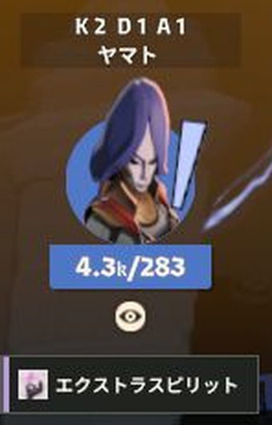

**アビリティ強化**

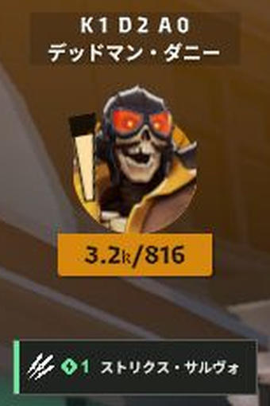

**アビリティの解放**

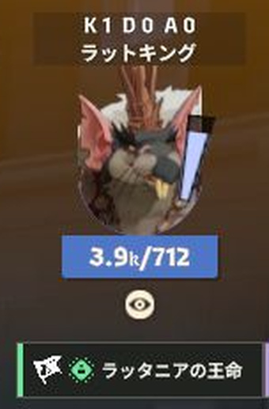

### 総資産と手持ちを分けて見る

各キャラに名前とK/D/A、**総資産／手持ち**を表示します。「4.1k／909」なら総資産は約4,100、手持ちは909ソウルです。取得できた本人の増減を金額欄に重ねて通知します。画面上部中央の試合時間の下には両チームの総資産を表示します。開始5分後からは、試合時間の横（優勢チーム側）に資産差を％で表示します。相手チームの総資産が割合の基準です。

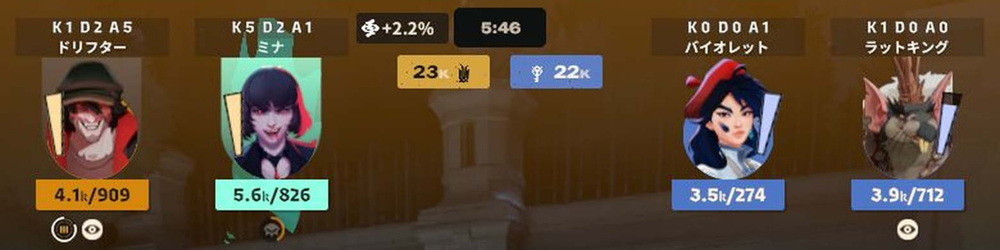

### 詳細画面で所持アイテムを見比べる

ゲームで設定しているキーで**スコアボード（詳細表示）を開くと**、各キャラの所持アイテムを**横3列**に整理して表示します。集団戦のあとなど、画面が落ち着いたところで構成を見比べられます。上部のキャラ情報とミニマップ上のタイマーも残ります。

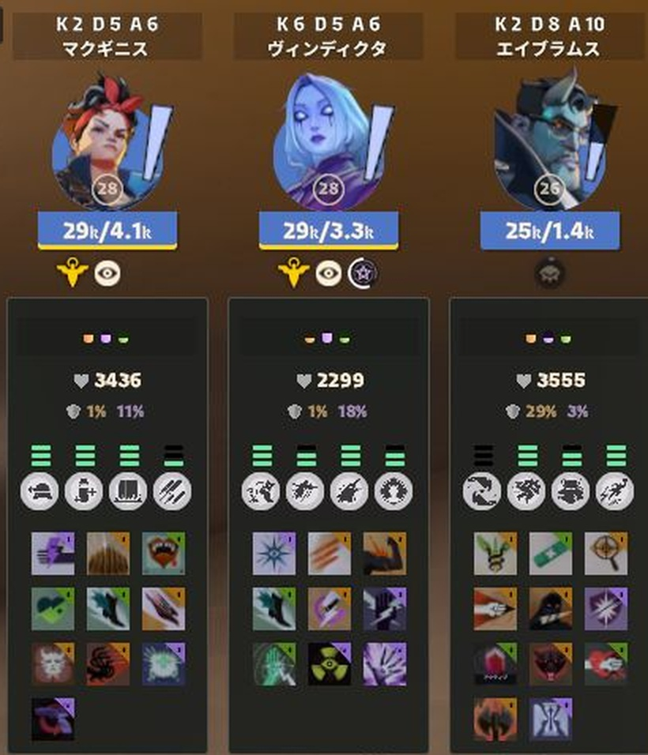

### 効果が付いた瞬間を知らせる

対応するスタン・スロー・サイレンス・カース・変身・無敵などを、**キャラアイコンの脇に、名前なしのアイコン**で通知します。写真ではバイオレットの横に3つ並んでいます。

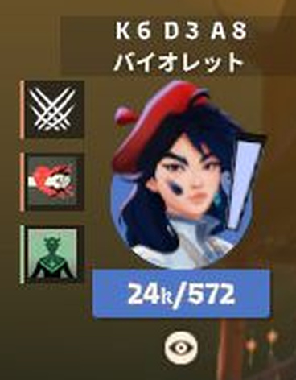

新たな付与を約3秒表示し、4つまでは並べ、5つ以上は重ねます。効果の残り時間ゲージではありません。表示するのは、HUDが対応している効果です。

### 壺・ブリッジバフの所持者を見る

短い効果通知とは別に、壺は所持者のキャラアイコン上側に表示します。ブリッジバフは、金額欄の下のアルティメットアイコン横に最大2個並び、白い縁取りが残り時間を示します。写真のシルバーでは、左の2つがブリッジバフです。

| 壺を所持 | ブリッジバフを2個所持 |
| :---: | :---: |
| 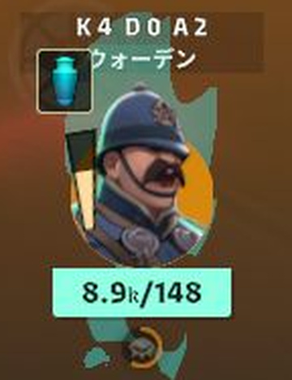 | 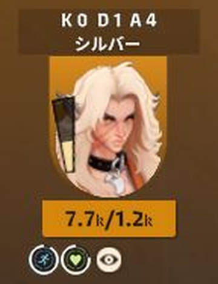 |

### リジュベネーターの使用権を見る

使用権が残るキャラには、**金額欄の下に黄色い専用アイコン**を表示します。チームの残回数は、**画面上部中央の試合時間の下**にアイコンと「×3」のような回数で表示します。個人の使用権とチームの残回数は別の情報で、所持しているキャラの人数を示す数字ではありません。写真の「×3」は右チームの残回数です。

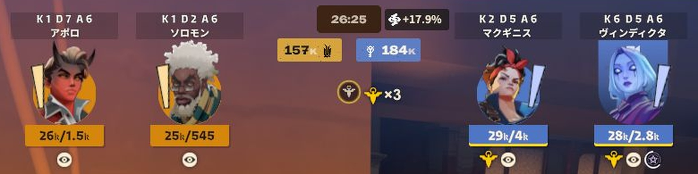

### レーンごとの建物HP

ガーディアン・ウォーカー・ベースガーディアンは、被弾すると**キャラ欄より下の画面左右**にHPを表示し、最後の被弾から約5秒残します。**同じレーンで同時に出る建物だけ**横に詰めて並べ、ベースガーディアン2体は別々のHPを表示します。常に全建物を一覧表示する機能ではありません。

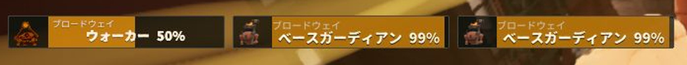

シュラインは横2列、パトロンは形態に応じた表示。ミッドボスにも専用のHP表示があります。

### ミニマップ上のタイマー

ブリッジバフは**次の出現予定まで**、ミッドボスはゲームから取得できた再出現カウントダウンや「出現中」を表示します。HUDが情報を得られなければ「—」になります。取ったブリッジバフの残り時間はキャラ欄の白い縁取りで示します。

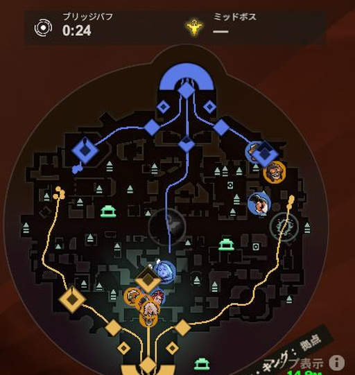

## 最初の使い方

**他のMODとの併用は動作未確認です。競合による表示崩れや不具合はサポート対象外です。**

Windows 10・11の64bit版と、Steam・Deadlockが必要です。実行環境が含まれるため、Python・Node.js・.NETの別途導入は不要です。

1. [Release](https://github.com/aominn/deadlock-spectator-hud-public/releases/tag/v0.6.1)から **DeadlockSpectatorHUD-0.6.1-win-x64.zip** を入手し、**すべて展開**します。ZIP内から直接起動しないでください。
2. Deadlockを終了し、展開先の **HudManager.exe** を開きます。
3. **Deadlock/game/citadel** フォルダーを指定し、 **「準備する」** を押します。画像はそのPCにインストールしたゲームから用意します。
4. **「HUDを有効にする」→「ゲームを起動」** から、観戦・対応するリプレイを開きます。

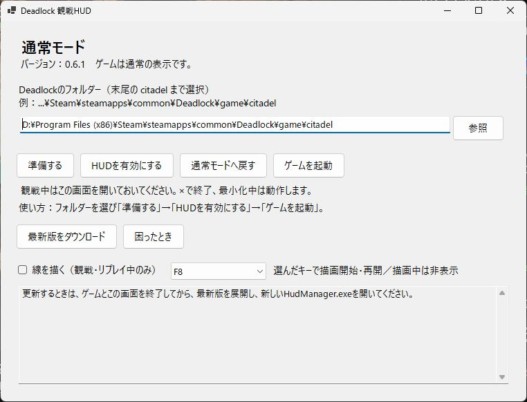

古いリプレイは現行ゲームと互換性がない場合があります。長いシークでゲームが終了する場合もあります。ライブ観戦からリプレイへ切り替えるときは、観戦を退出してから開いてください。

観戦中は管理画面を開いておきます。最小化中は継続し、**×で閉じると補助処理も終了**します。×で閉じるだけでは通常モードには戻りません。途中参加や初回解析では準備を待ってください。

## 画面に線を描く

注目してほしい場所を丸で囲んだり、移動する方向を矢印で示したり、**観戦画面にマウスで直接描き込んで解説**できます。ミニマップ上にも描けます。

管理画面の **「線を描く（観戦・リプレイ中のみ）」** にチェックし、ゲーム画面で **F8** を押します。キーは管理画面で変更できます。

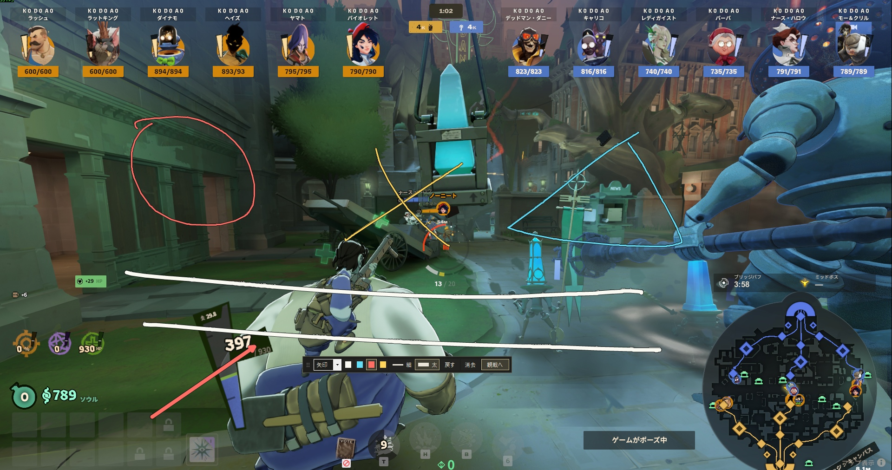

- ツールバーで4色・細い線／太い線・ペン／矢印を選べます。「戻す」「消去」も使えます。
- **「観戦へ」またはEsc** で線とツールバーを残してゲーム操作へ戻ります。**F8または「描く」** で描画を再開できます。
- **描画中のF8** はツールバーを隠してゲーム操作へ戻ります。非表示のときはF8で表示して描画を開始します。どちらの切替でも線は残ります。
- 画面全体へ描けるのでミニマップ上にも描けます。線は画面上の位置に固定され、カメラには追従しません。
- 別ウィンドウへの切替では線を保持し、シーク・別試合・通常モード復帰・ツール終了では消去します。
- 描画チェックは管理画面を開くたびに設定します。描画中はFPSが下がる場合があります。

[描画の詳しい説明](docs/DRAWING.txt)

## 通常の表示に戻す・更新する

**通常プレイへ戻るとき**：Deadlockを終了し、管理画面の **「通常モードへ戻す」** を押します。再びHUDで観戦するときは、ゲームを終了して「HUDを有効にする」→「ゲームを起動」を選びます。

ゲーム更新後に表示が崩れた場合は通常モードへ戻し、対応版をお待ちください。

**更新**：管理画面の「最新版をダウンロード」または[GitHub Releases](https://github.com/aominn/deadlock-spectator-hud-public/releases)から新しい実行用ZIPを入手します。ゲームと管理画面を閉じ、最新版ZIPを新しいフォルダーへすべて展開。その中のHudManager.exeを開き、管理画面の案内に従ってHUDを有効にし、ゲームを起動します。ファイルを個別に差し替える必要はありません。

**困ったとき**：ゲームを終了して **「困ったとき」** からファイル確認・画像の読み直し・保持された前版への復帰を行えます。[導入と復旧](docs/INSTALL.txt)

## 表示言語

管理画面・描画ツールは **Windowsの表示言語**、ゲーム内の追加表示は **Deadlockの言語** に従います。それぞれ日本語なら日本語、それ以外は英語です。写真は日本語環境です。

## 不具合・お問い合わせ

不具合は[GitHub Issues](https://github.com/aominn/deadlock-spectator-hud-public/issues)へ、HUDの版、ゲームの言語、観戦／リプレイ、再現手順を添えてください。認証情報を含むログは公開しないでください。GitHubを使わない場合は[お問い合わせ](https://aominn.jp/form/)からも連絡できます。

## 非公式ツール・ライセンス

Valveによる開発・承認・サポートを受けたツールではありません。通常プレイ用ではなく、観戦・リプレイ用です。

ゲームのアイコン・標準UI原本・ゲーム字体・生成済みMODは実行用ZIPへ同梱せず、利用先のゲームから準備します。このREADMEの写真は説明用で、ゲーム素材の権利は各権利者に帰属します。

自作コードは[MIT](LICENSE)。第三者部品と説明用写真の扱いは[ライセンス案内](THIRD_PARTY_NOTICES.txt)を参照してください。写真の撮影条件・加工内容は[画像の来歴](docs/images/README.txt)に記載しています。

[変更履歴](docs/CHANGELOG.txt) · [開発手順](docs/BUILD.txt) · [配布検査](docs/PORTABLE.txt) · [素材準備](docs/LOCAL-ASSETS.txt)
